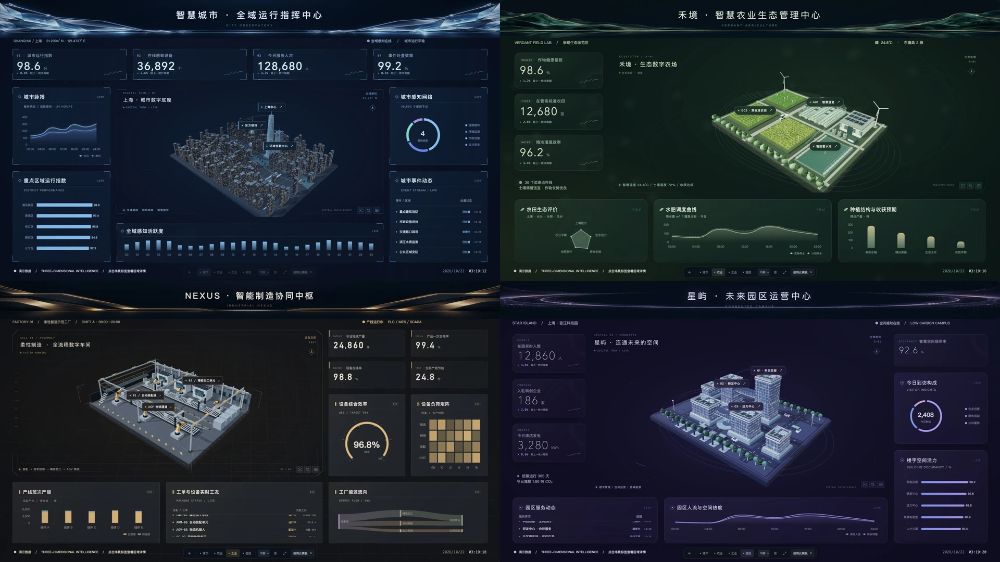
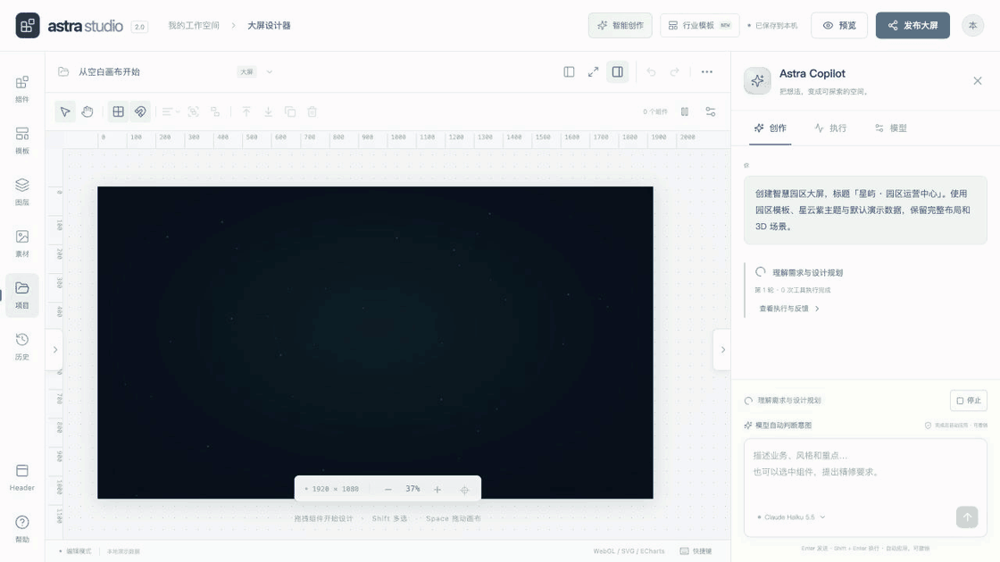
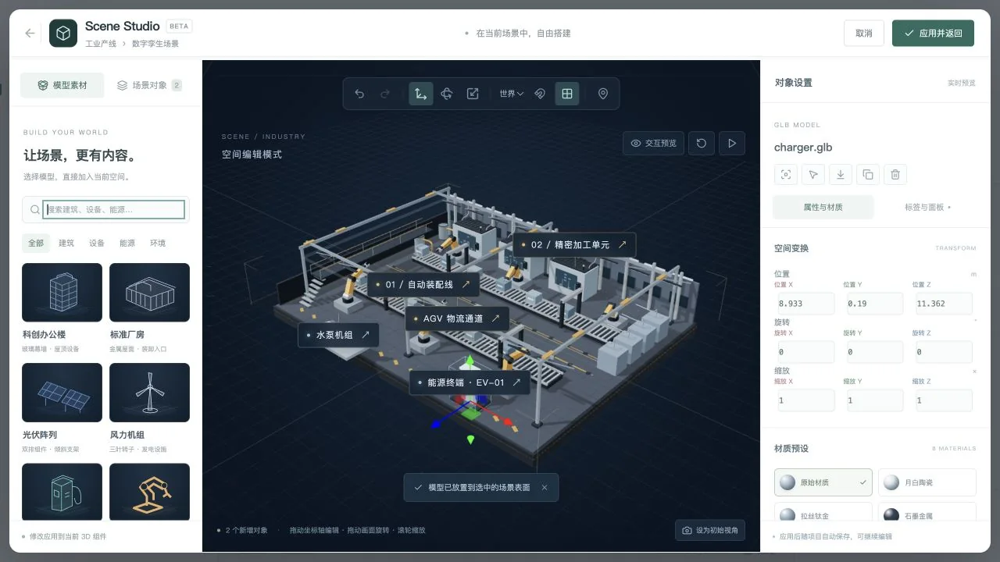
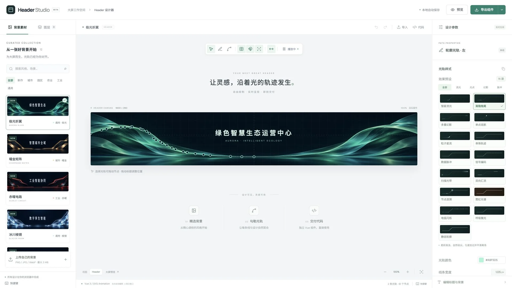

<div align="center">

# Astra Studio

Interaktive 3D-Dashboards mit natürlicher Sprache gestalten.

**Vue 3 · Three.js · ECharts · MIT**

[中文](README.md) · [English](README.en.md) · [日本語](README.ja.md) · [Deutsch](README.de.md)

[Studio öffnen](https://yinweinidongle.github.io/big-screen-astra/) · [KI-Copilot](https://shanghai-city-observatory.brainy-pony-0848.chatgpt.site/?assistant=1) · [Header Studio](https://yinweinidongle.github.io/big-screen-astra/header-studio/)

</div>



## Eine Eingabe. Ein editierbares Dashboard.



**32 Werkzeuge** für Planung, Layouts, Diagramme, Szenen und Frontend-Code. Der Copilot erkennt, ob ein neues Dashboard oder eine Überarbeitung gefragt ist. Mit Folgeänderungen, Laufzeitprüfung, Fortsetzen und Rückgängig pro Durchlauf.

<sub>In dieser echten Aufnahme: 15 Komponenten in 9,6 Sekunden mit Demodaten. Die Dauer hängt vom Modell und vom Netzwerk ab.</sub>

<sub>Echte Interaktionen; Wartezeiten und Wiederholungen wurden gekürzt.</sub>

<details>
<summary>Komponenten gezielt bearbeiten</summary>

Titel und Kennzahlenkarte ändern, das übrige Dashboard beibehalten.


</details>

<details>
<summary>Shader schreiben und verfeinern</summary>

Einen eigenen GLSL-Energiering in die bestehende Szene einfügen.


</details>

<details>
<summary>Szenenmaterialien wechseln</summary>

Graphit, Bernsteinlegierung und blaues Glas. Positionen und Beschriftungen bleiben erhalten.


</details>


## Kernfunktionen

| Bereich | Funktionen |
| --- | --- |
| **Freie Arbeitsfläche** | Ziehen, skalieren, mehrfach auswählen, gruppieren und ausrichten. Seitenleisten einzeln einklappen oder den Fokusmodus nutzen. |
| **Visualisierung** | 30 Komponenten und 14 Diagrammtypen. Animierte Kennzahlen, Lauflisten, Glow, Vignette und Farbmatrizen. |
| **3D-Bearbeitung** | GLB/glTF, Gebäude und Geräte in bestehende Szenen einfügen. Materialien, Shader, Animationen und interaktive POIs bearbeiten. |
| **Frontend-Code** | JS / HTML / CSS / GLSL generieren. Echte Kompilierung, Laufzeitfeedback, mehrere Dateien und Quellcode-Export. |
| **Header Studio** | 12 Hintergründe und 15 Lichtspur-Effekte. SVG-Pfade zeichnen, spiegeln, an Schnittpunkten kürzen und als Vue-Komponenten exportieren. |
| **Daten und Freigabe** | JSON, HTTP, WebSocket, D1 SQL und verknüpfte Interaktionen. Projektpakete, Versionen und Freigabe per Passwort oder Token. |

<table>
<tr>
<td width="50%"></td>
<td width="50%"></td>
</tr>
<tr><td align="center">Scene Studio</td><td align="center">Header Studio</td></tr>
</table>

## Branchenvorlagen

[Smart City](https://yinweinidongle.github.io/big-screen-astra/templates/city/) · [Landwirtschaft](https://yinweinidongle.github.io/big-screen-astra/templates/agriculture/) · [Industrie](https://yinweinidongle.github.io/big-screen-astra/templates/industry/) · [Campus](https://yinweinidongle.github.io/big-screen-astra/templates/campus/) · [Satellitenkarte](https://yinweinidongle.github.io/big-screen-astra/templates/gis/) · [3D-Vektorkarte Chinas](https://yinweinidongle.github.io/big-screen-astra/templates/regions/)

## Schnellstart

Node.js **22.12+**

```bash
git clone https://github.com/yinweinidongle/big-screen-astra.git
cd big-screen-astra
npm ci
npm run dev
```

Copilot verbinden: `.dev.vars.example` nach `.dev.vars` kopieren und Modell-API-Schlüssel sowie Verschlüsselungsschlüssel eintragen. Unterstützt OpenRouter, DeepSeek, Qwen, Kimi, OpenAI, Anthropic, Gemini und kompatible Endpunkte.

[Entwicklung & Deployment](docs/development.md) · [Code-API](docs/frontend-code-agent.md) · [Agentenarchitektur & Audit](docs/agent-workflow-audit.md)

<sub>GitHub Pages bietet den statischen Editor. KI, Cloud-Speicherung und geschützte Freigaben benötigen den vollständigen Dienst. Die Editor-Oberfläche ist derzeit auf Chinesisch.</sub>

---

[MIT](LICENSE) · [Hinweise zu Drittanbietern](THIRD_PARTY_NOTICES.md) · [Lizenzen der Kartendaten](public/assets/maps/ATTRIBUTION.md)
