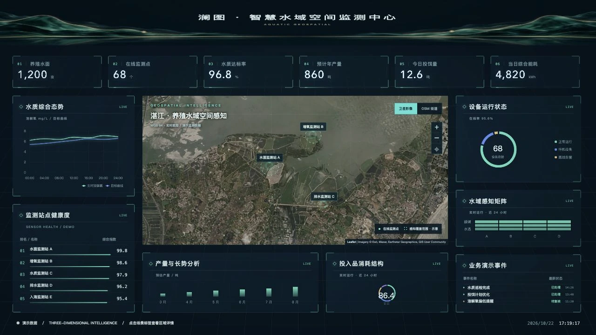
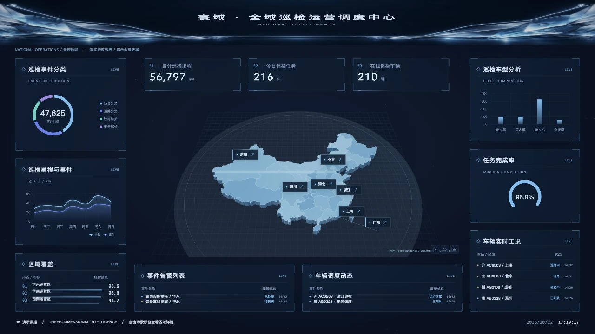

<div align="center">

# Astra Studio

自然言語で、対話できる 3D データダッシュボードを。

**Vue 3 · Three.js · ECharts · MIT**

[中文](README.md) · [English](README.en.md) · [日本語](README.ja.md) · [Deutsch](README.de.md)

[エディター](https://yinweinidongle.github.io/big-screen-astra/) · [AI Copilot](https://shanghai-city-observatory.brainy-pony-0848.chatgpt.site/?assistant=1) · [Header Studio](https://yinweinidongle.github.io/big-screen-astra/header-studio/)

</div>


## ひとつの指示から、編集可能な大画面へ。


**32 個のツール**で計画、レイアウト、グラフ、シーン、フロントエンドコードを作成。新規作成と既存作品の改善を自動判定し、継続編集、実行検証、中断からの再開、ターン単位の取り消しに対応。

<sub>実測ではデモデータの 15 コンポーネントを 9.6 秒で生成。所要時間はモデルとネットワークに依存します。</sub>

<sub>実際の操作を録画し、待ち時間と重複部分をカットしています。</sub>

<details>
<summary>コンポーネントを部分編集</summary>

ほかの要素を保持し、タイトルと数値カードを更新。


</details>

<details>
<summary>Shader の作成と調整</summary>

既存シーンにカスタム GLSL のエネルギーリングを追加。


</details>

<details>
<summary>シーンのマテリアル切り替え</summary>

グラファイト、琥珀合金、青いガラス。位置とラベルはそのまま。


</details>


## 主な機能

| 機能 | 内容 |
| --- | --- |
| **自由なキャンバス** | ドラッグ、拡縮、複数選択、グループ化、スナップ。左右パネルの開閉と集中モード。 |
| **可視化** | 30 コンポーネント、14 種類のグラフ。数字アニメーション、スクロールリスト、Glow、ビネット、色彩行列。 |
| **3D 編集** | 既存シーンに GLB/glTF、建物、設備を追加。マテリアル、Shader、アニメーション、対話 POI を編集。 |
| **フロントエンド開発** | JS / HTML / CSS / GLSL を生成。実コンパイル、実行フィードバック、複数ファイル、ソース出力。 |
| **Header Studio** | 12 背景、15 種類の光跡。SVG パス描画、ミラー、交点トリミング、Vue 部品の出力。 |
| **データと配信** | JSON、HTTP、WebSocket、D1 SQL、部品連動。プロジェクトパック、履歴、パスワード / Token 共有。 |

<table>
<tr>
<td width="50%"></td>
<td width="50%"></td>
</tr>
<tr><td align="center">Scene Studio</td><td align="center">Header Studio</td></tr>
</table>

## 業界テンプレート

[都市](https://yinweinidongle.github.io/big-screen-astra/templates/city/) · [農業](https://yinweinidongle.github.io/big-screen-astra/templates/agriculture/) · [工業](https://yinweinidongle.github.io/big-screen-astra/templates/industry/) · [キャンパス](https://yinweinidongle.github.io/big-screen-astra/templates/campus/)

<table>
<tr>
<td width="50%"></td>
<td width="50%"></td>
</tr>
<tr>
<td align="center"><a href="https://yinweinidongle.github.io/big-screen-astra/templates/gis/">衛星地図</a><br /><sub>Leaflet · 衛星画像 · 観測点の操作</sub></td>
<td align="center"><a href="https://yinweinidongle.github.io/big-screen-astra/templates/regions/">中国 3D ベクトル地図</a><br /><sub>Three.js · 立体行政区 · 地域フォーカス</sub></td>
</tr>
</table>

## クイックスタート

Node.js **22.12+**

```bash
git clone https://github.com/yinweinidongle/big-screen-astra.git
cd big-screen-astra
npm ci
npm run dev
```

Copilot の接続：`.dev.vars.example` を `.dev.vars` にコピーし、モデルの API キーと暗号化キーを設定します。OpenRouter、DeepSeek、Qwen、Kimi、OpenAI、Anthropic、Gemini と互換 API に対応。

[開発とデプロイ](docs/development.md) · [コード API](docs/frontend-code-agent.md) · [エージェントの設計と監査](docs/agent-workflow-audit.md)

<sub>GitHub Pages は静的エディターです。AI、クラウド保存、保護された共有にはフルサービスが必要です。エディターの UI は現在中国語です。</sub>

---

[MIT](LICENSE) · [サードパーティー表記](THIRD_PARTY_NOTICES.md) · [地図データのライセンス](public/assets/maps/ATTRIBUTION.md)
