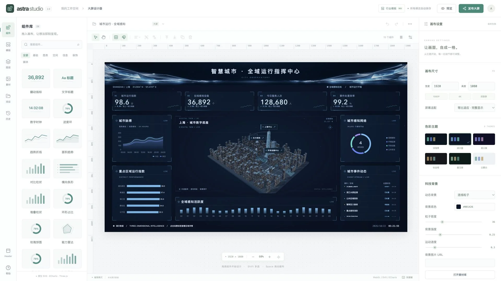
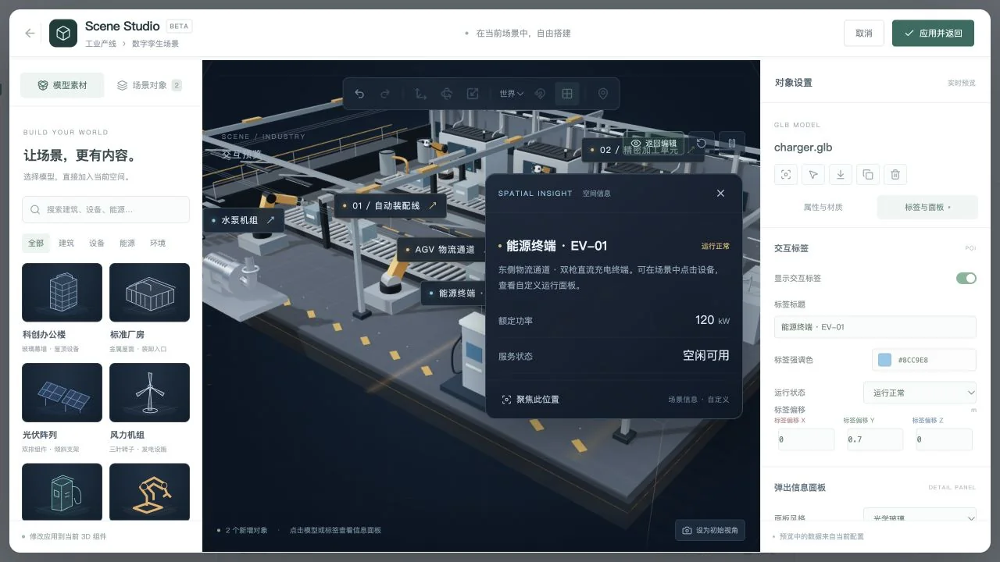
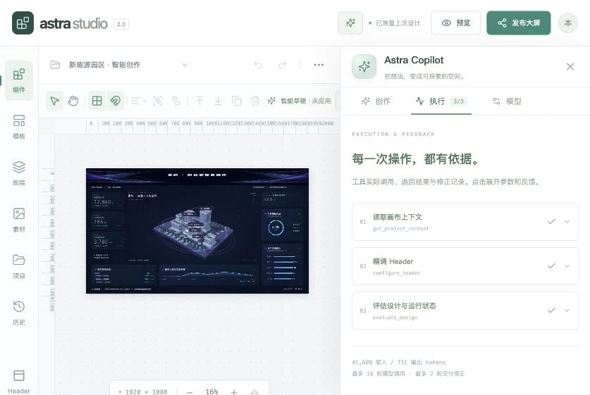
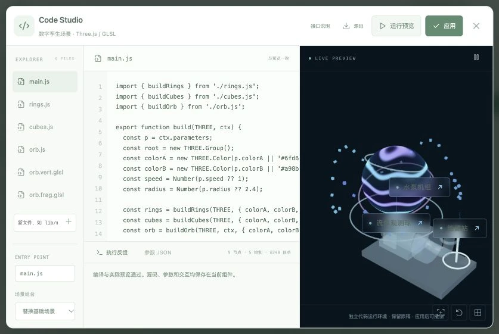
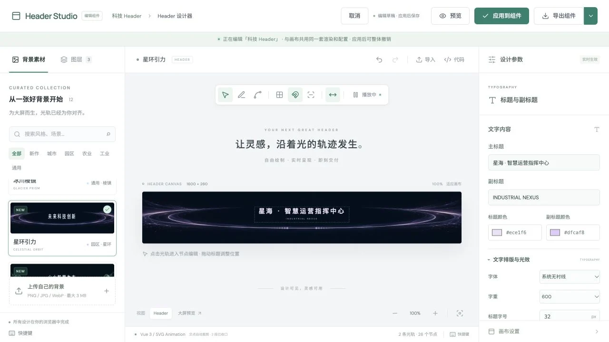

<div align="center">

# Astra Studio

### 把数据，变成可以探索的空间。

Vue 3 可视化大屏工作台 · Three.js 数字孪生 · SVG Header 设计器

[中文](README.md) · [English](README.en.md) · [日本語](README.ja.md)

[在线体验](https://yinweinidongle.github.io/big-screen-astra/) · [行业模板](https://yinweinidongle.github.io/big-screen-astra/templates/city/) · [Header Studio](https://yinweinidongle.github.io/big-screen-astra/header-studio/) · [完整服务版](https://shanghai-city-observatory.brainy-pony-0848.chatgpt.site/)

   


</div>

Astra Studio 将自由画布、数据图表、真实 3D 场景和科技感标题编辑放在同一个工作空间。选择模板即可预览；每个组件的布局、样式、数据和交互都可以继续调整。所有内置业务数据均为演示数据。README 提供三语版本，编辑器当前为中文界面。

## 从模板开始

四套模板使用不同的布局、面板、图表和场景语言，而非简单换色。

| 模板 | 视觉与场景 | 体验 |
| --- | --- | --- |
| 城市运行 | 冷蓝指挥舱；342 栋实例化建筑、陆家嘴地标、桥梁、滨水步道与车流 | [城市](https://yinweinidongle.github.io/big-screen-astra/templates/city/) |
| 精准农业 | 翡翠与暖金；温室、1,134 株作物、果树、灌溉过滤系统与无人机 | [农业](https://yinweinidongle.github.io/big-screen-astra/templates/agriculture/) |
| 工业智造 | 石墨与琥珀；开放车间、机械臂、AGV、输送线、管线与检修走道 | [工业](https://yinweinidongle.github.io/big-screen-astra/templates/industry/) |
| 未来园区 | 紫银玻璃；幕墙楼宇、空中连廊、屋顶光伏、充电设施与喷泉 | [园区](https://yinweinidongle.github.io/big-screen-astra/templates/campus/) |

## 创作工作台



- **自由布局**：拖拽、八向缩放、多选、组合、层级、锁定、智能吸附、对齐与等间距排列；适应、铺满、宽度自适应和拉伸模式。
- **完整视觉配置**：30 个组件、14 种图表、6 种主题、6 种背景、8 种边框；数字翻动、滚动列表、渐变、辉光、暗角与色彩矩阵。
- **空间组件**：Three.js 场景、智慧地球、GLB/glTF 模型、材质与动画、FlyTo、自动巡航、模型拾取及 POI 看板；Mapbox 支持建筑与 DEM 地形，需自行提供公开 Token。
- **数据与联动**：静态 JSON、HTTP、WebSocket、字段映射、刷新周期、点击与悬浮事件、筛选和下钻。SQL 使用 Worker 中的受限 D1 查询；外部数据库通过自己的 HTTP 网关接入。
- **可迁移项目**：IndexedDB 本机保存、撤销重做、历史快照；JSON 和包含素材的 `.astra.zip` 导入导出。

## Scene Studio · 在已有场景中搭建


在工作台中点击工具栏的 **场景编辑**，或选中 3D 组件后点击 **进入 3D 场景编辑**。编辑器会保留当前城市、农场、工厂或园区，新增模型作为该组件内部的对象保存。

1. 从 10 款程序化模型中选择办公楼、厂房、光伏、风机、充电桩、机械臂、水泵、摄像头、乔木或集装箱；另有 3 款单体 GLB 设备，可直接使用，也可上传自己的 GLB/glTF。
2. 用坐标轴移动、旋转、缩放，或点击场景表面摆放。支持世界 / 局部坐标、吸附、复制、显隐、锁定、撤销重做和初始视角保存。`W / E / R` 切换工具，`F` 聚焦。
3. 从 8 种材质预设开始，调整颜色、金属度、粗糙度、透明度、自发光与全息扫描；为新增对象配置旋转、悬浮或脉动，也可播放 GLB 内置动画。
4. 为模型配置跟随位置的标签，或在场景表面独立放置标签。弹出面板支持标题、说明、状态、最多 8 行信息、强调色和 HTTP/HTTPS 详情链接；点击 **交互预览** 即可体验。
5. **应用并返回** 会保存到原组件。模型素材随 `.astra.zip` 导入导出，标签和变换随项目、快照及发布配置保留。

每个 3D 组件最多添加 64 个对象。内置场景作为基础层保留，新增模型和标签可独立编辑；编辑对象不会重新构建基础场景。弹出面板的信息字段由用户配置，组件之间的数据联动仍可在「交互」面板设置。



## Astra Copilot · 大屏设计智能体



点击右上角「智能创作」，描述业务、风格、重点指标和场景。助手通过 **26 项工具** 创建可编辑作品，根据用户意图自动判断新建或优化，无需手动选择模式；也能针对选中组件精修 Header、图表、材质、已有 3D 场景与交互标签。

- **执行 → 反馈 → 评估 → 修正**：每个工具的输入、返回结果、耗时和失败反馈都可展开查看。检查实际 DOM、文字溢出、边界、图表字段、交互引用和 Three.js 运行指标，最多 16 轮调用、2 轮修正。
- **草稿与原稿分离**：生成时直接在画布预览，可对比原稿；点击应用后保持原生可编辑，支持整体撤销。锁定和选中范围受到保护；原稿发生手动修改时阻止旧结果覆盖。完成的草稿可在刷新后恢复。
- **模型自由配置**：默认 OpenRouter / `anthropic/claude-haiku-5.5`。支持 DeepSeek、通义千问、智谱、Kimi、豆包、硅基流动、MiniMax、OpenAI、Anthropic、Gemini 和自定义 HTTPS 兼容接口，可刷新模型列表、输入模型 ID、测试实际函数工具调用。其他厂商使用各自密钥，实际模型能力以厂商为准。
- **密钥在服务端**：默认密钥限工作空间所有者使用；个人连接按账号隔离，API Key 通过 AES-GCM 加密存入 D1，不进入前端构建、项目 JSON 或导出包。修改接口地址后必须重新填写对应密钥。

评分代表结构与运行检查，不代表已完成图片审美评估。没有提供真实数据时使用演示数据；配置数据源不会冒充已连接成功。生成支持停止，已经执行的部分仍可预览。

**本地配置**：复制 `.dev.vars.example` 为 `.dev.vars`，填写 `AGENT_DEFAULT_API_KEY`、`AGENT_DEFAULT_MODEL` 和稳定的 64 位十六进制 `AGENT_ENCRYPTION_KEY`，再运行 `npm run dev`。本地模式无需登录。生产部署将相同配置设为运行时 Secret，并配置 `AGENT_DEFAULT_OWNER_ID` 或 `AGENT_DEFAULT_OWNER_EMAIL`；使用 Sites 托管身份登录，不能把密钥放在 `VITE_*` 变量里。加密密钥更换后需重新保存个人模型密钥。

**GitHub Pages** 为静态编辑器，无法保存服务端密钥；「携带项目打开智能创作」会通过严格来源校验的窗口通道，将当前项目、输入意图和本机素材带入完整服务版（素材总量上限 100 MB）。完整服务版登录后即可继续生成。接收过程保留原项目，不自动触发付费模型调用。

## Code Studio · 前端编程工作区



智能体可以直接编写前端代码，按需求创造模型、图表、粒子、Shader 和交互。支持多文件 JS / HTML / CSS / GLSL / JSON、精确修改、检查点恢复、参数编辑和源码导出。Three.js 代码接入现有场景；自定义界面作为原生可布局的代码组件保存。业务造型与算法由代码生成。

「编写 → 实际编译运行 → 错误反馈 → 修正 → 评估」进入同一工具闭环，JS、GLSL 与运行异常都可反馈给模型。生成代码先预览，通过后应用，可整体撤销。[接口、架构来源与运行边界](docs/frontend-code-agent.md)。

## Header Studio


12 款背景预设搭配经过校准的 SVG 光轨，可上传背景、绘制折线与曲线、拖动节点与标题、同步镜像，并自动裁剪交点后的多余线段。

15 种效果包括彗星、渐隐拖尾、幻影、巡航光点、粒子、串珠、脉冲、信号编码、扫描、双向汇流、涟漪、光谱、电弧、呼吸与静态轮廓。颜色、速度、方向、粗细和光晕均可配置。

导出独立 Vue 单文件组件，或下载包含组件、图片和 JSON 的 ZIP。组件只依赖 Vue 3.5+。`P` 绘制折线，`B` 绘制曲线，`Enter` 完成，`V` 选择，`Space` 暂停，`Ctrl/⌘ Z` 撤销。

科技 Header 组件与设计器共用完整配置和 SVG 渲染器。选中组件 →「进入 Header 设计器」→「应用到组件」即可原地精调，不离开大屏；预览使用当前大屏的真实布局和 3D 场景。字体、字重、字号、位置、字距、渐变、文字辉光、透明度和适配方式均即时生效。切换预设保留标题；支持取消保护、撤销、重新打开和项目导入导出。独立设计器的「用于大屏」也能把设计带回工作台，确认应用后更新 Header。




## 本地启动

需要 **Node.js 22.12+** 和 npm。

```bash
git clone https://github.com/yinweinidongle/big-screen-astra.git
cd big-screen-astra
npm ci
npm run dev
```

`npm run dev` 自动应用本地 D1 迁移，并启动 Vite `:5173` 和 Worker `:8787`。仅本机开发启用模拟开发账号。

```bash
npm test                 # 工作台、场景、真实 D1/R2、Header 与裁剪检查
npm run build            # 完整前端 + Worker 构建
npm run preview          # 本地预览完整构建
npm run build:pages      # 生成 dist/pages 静态站点
npm run preview:pages    # 预览 Pages 构建
```

## 两种部署方式

| 能力 | GitHub Pages | Worker + D1 + R2 |
| --- | :---: | :---: |
| 行业模板、3D 场景、Header 编辑与组件导出 | ✓ | ✓ |
| 本机项目、素材、快照与项目包 | ✓ | ✓ |
| 浏览器直连 HTTP / WebSocket | 需上游允许 CORS / 连接 | ✓ |
| 账号隔离的云端项目与素材 | — | ✓ |
| D1 SQL、发布快照、密码 / Token 分享 | — | ✓ |

**GitHub Pages**：`.github/workflows/pages.yml` 在推送到 `master` / `main` 后运行检查、构建并部署。仓库 Settings → Pages 的 Source 选择 **GitHub Actions**。默认子路径为 `/big-screen-astra/`，工作流根据仓库名设置；自定义构建可用 `PAGES_BASE_PATH=/my-repo/ npm run build:pages`。页面具有独立 HTML 入口，支持嵌套路径直接访问和刷新。参考 [Vite 部署说明](https://vite.dev/guide/static-deploy.html#github-pages)。

**完整服务**：`npm run build` 输出 `dist/client` 和 `dist/server`。Worker 需要 `ASSETS`、D1 `DB`、R2 `BUCKET` 绑定，并应用 `drizzle/` 迁移。云端写入使用 Sites 提供的可信身份；移植到其他宿主时需要适配服务端身份验证。不要在生产启用 `LOCAL_DEV`。受保护分享由服务端验证，纯静态站点不能替代该后端。

## 页面入口

以下路径相对于部署基础路径：

| 路径 | 页面 |
| --- | --- |
| `/`、`/studio/` | 可视化工作台 |
| `/templates/city/`、`/templates/agriculture/`、`/templates/industry/`、`/templates/campus/` | 四套可编辑行业模板预览 |
| `/header-studio/` | Header 设计器 |
| `/city/`、`/demo01/`、`/demo02/`、`/demo03/` | 保留的独立城市、农业、工业与园区大屏 |
| `/player/` | 本机项目播放器 |
| `/view/:slug` | 后端发布的大屏，需要完整服务 |

## 性能与项目结构

采用建筑与植被实例化、静态几何合批、按需分包、缓存阴影、自适应 DPR；隐藏页面或离开视野时停止绘制，暂停时按需渲染，卸载时释放 GPU 资源。三档画质分别提供最高 30 / 30 / 60fps 和 1× / 1.5× / 2× DPR 上限，实际表现取决于设备、分辨率与浏览器。

```text
src/workbench/          画布、配置 schema、组件、数据连接与详细 3D 场景
src/studio/             Header 编辑器、SVG 光轨、预设与 Vue/ZIP 导出
src/demos/              保留的独立行业大屏
src/paths.js            域名根路径与 Pages 子路径适配
server/                 身份、授权、项目、发布、SQL 与素材服务
db/ · drizzle/          D1 数据声明与迁移
scripts/                开发、构建、几何与集成检查
docs/screenshots/       实际运行截图
```

## 贡献与许可证

欢迎通过 Issue 报告问题，或提交 Pull Request。提交前运行 `npm test` 和 `npm run build:pages`；修改场景时请检查四套模板的动效、暂停、POI 与渲染开销。

项目原创代码以 [MIT License](LICENSE) 开源。依赖包、字体、地图服务与公共领域地理数据的说明见 [第三方声明](THIRD_PARTY_NOTICES.md)。背景素材包含 AI 生成的艺术设计，提示词保存在 `docs/`。程序化模型与演示数据不代表真实地理测绘或设备运行情况。
