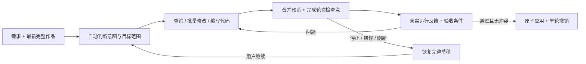

# Astra Copilot 工作流审计

2026-10-22。目标是让用户直接描述需求，持续修改同一作品；过程可观察，失败可继续，交付可撤销。审计覆盖模型代理、工具契约、草稿引擎、前端代码运行、数据运行时、存储与面板。

## 发现的问题与已完成修改

| 问题 | 影响 | 本轮处理 |
| --- | --- | --- |
| 每个工具深复制并推送全屏草稿 | 标题修改也让图表与 3D 接收新对象；重复触发数据检查 | 按需复制被修改节点，保留其他节点与全局变量引用；同轮合并预览，在代码运行与评估前立即刷新 |
| 上下文重复读取，长对话不断增长 | 等待、token 和内存开销增长 | 预装当前真实 ID 与画布摘要；版本化查询缓存；大作品精简摘要，按 ID 查询详情；保持工具协议完整地整理历史 |
| 工具回执体积没有总预算 | 大数据表把请求撑大；粗暴截断可能破坏 JSON | 模型回执控制在 32,000 字符内，返回合法 JSON 与缩小查询提示；缓存也只保存精简回执，完整源码与数据仍在草稿 |
| 调用去重只依赖工具 ID | 厂商复用 ID 时可能返回另一次调用的旧结果 | 结合工具名、参数、调用 ID 与查询版本；实时检查每次实际执行，失败回执允许修正重试 |
| 输出被截断或返回异常工具批次 | 部分无效输出可能直接执行 | 截断输出不执行整批工具；未知工具、重复调用 ID、过长批次要求重新输出；设置轮数、工具数、时间与修正预算 |
| 停止或关闭时只保留最终结果 | 长任务完成一半也可能丢失 | 已完成工具轮次写本机检查点；串行写入避免旧草稿复活；停止保留完整部分作品，刷新后手动继续，不自动发起付费调用 |
| 恢复后“没有新增修改”被当成没有作品 | 丢弃恢复前已完成但未应用的内容 | 交付差异始终与原稿比较；继续完成时无需再修改也可保留并应用此前成果 |
| 缺少查询、差异与场景管理工具 | 模型猜组件、猜对象，难以检查修改范围 | 新增 6 项工具，合计 32 项；见下表 |
| 局部要求缺少明确编辑边界与验收 | 修改扩散、误删难以发现 | 计划支持 targetIds、removeIds、标题/属性/存在性/数量验收；原有删除须先声明；锁定、选中和目标边界由引擎强制执行 |
| Header 显示标题与通用 title 不一致 | 标题已正确却反复验收失败 | 同步 Header 写入；查询与验收都使用统一的显示标题语义；Header schema 明确指向 configure_header |
| 复制/删除未处理关联关系 | 复制组件仍指向旧对象，删除留下无效联动 | 复制时映射内部事件目标与分组；移除时原子清理可编辑来源的入站关联，失败完整回滚 |
| 相同源码再次运行只校验 hash | 参数变化后可能把旧成功预览认作新结果 | 校验本次 activation；入口、组合方式与参数也纳入待运行判断；旧预览错误不覆盖新预览状态 |
| 自定义前端暂停后点击被误判超时 | 按钮可见但交互失效 | DOM 输入事件重置 CPU 执行预算；同步暂停 JS、CSS、Web Animations 与 SVG 动画，保持输入可用 |
| 少量 draw calls 可能包含大量高细分实例 | GPU 仍可能过载 | 代码层增加实例展开后的 50 万三角面预算、有限变换校验与 Shader 递增/嵌套循环限制；不变化的材质不跨 Worker 传输，缓冲使用转移 |
| 数据请求交叠，旧响应可写回新绑定 | 刷新后跳回旧值 | 连接与请求实例双重校验；旧请求与旧 WebSocket 回调不能覆盖新状态；移除组件清理运行数据；观察连接字段而非遍历整份静态数据 |
| 服务错误统一重试 | 无效密钥和模型也反复等待 | 区分鉴权、余额、模型、限流、网络、超时与响应过大；只对暂时故障有限重试；流式读取响应限制 2 MB，不回传厂商原始错误正文 |
| 应用、撤销与素材加载存在边界问题 | 异步加载期间覆盖手动调整；撤销丢失本机素材 | 应用先解析素材并再次核对原稿版本；切换原子提交；撤销/重做恢复素材，过期解析不能覆盖新状态；历史限制 70 步与约 24 MB，至少保留两份 |
| 响应式项目不能直接 structuredClone | 从本机列表打开已有作品失败 | 配置复制兼容 Vue 代理，同时保留校验对非有限值的处理；导出同样兼容 |
| 完成页重复状态多，缺少明确下一步 | 难以确认改了什么、怎么恢复 | 展示新增/修改/删除/保留数量、涉及组件、检查结果、耗时、预览更新次数；异常提供重试/继续完成，成功提供一键撤销 |

删除声明是执行约束，不代表宿主能可靠推断所有自然语言授权。模型仍需遵守用户意图；重要作品建议保留项目包与历史快照。

## 新增工具

| 工具 | 用途 |
| --- | --- |
| query_widgets | 按名称、标题、类型或 ID 批量查询；分页读取 |
| get_scene_state | 查看已有场景对象、材质、镜头、标签与代码清单 |
| inspect_runtime | 有界等待实际画布、数据状态、字段样例与运行指标，不额外请求数据 |
| get_design_changes | 读取实际新增、修改、删除、保留数量与字段分组 |
| duplicate_widgets | 保留源组件，复制内容、样式、数据、代码与内部联动 |
| remove_scene_objects | 从同一个场景移除指定模型或标签，保留基础世界 |

## 执行闭环

## 验证证据

- 真实默认模型调用：对现有 15 组件园区作品仅修改主标题，9.0 秒、3 次工具调用、3 轮模型回复、1 次草稿预览更新；修改 1 个组件，新增和删除均为 0，保留 14 个组件，全部挂载并自动应用。时间是本次样本，依赖模型服务与机器，不能视为通用延迟承诺。预览更新计数不包含最终画布提交。
- 恢复测试：先保留包含验收错误的草稿，重新载入后「继续完成」，真实模型检查通过并自动应用；「撤销本轮」恢复上一版标题及完整 15 组件。
- 代码交互测试：打开以前保存的模型生成作品，全局暂停后在预览中点击代码卡片「历史」，数值从 126 切换为 103，运行状态仍为 ready，未出现 CPU 超时。
- 自动回归：`npm test` 包含 12 个验证入口。新增 `verify-agent-workflow.mjs` 覆盖不可变快照、节点引用、范围限制、Header 验收、原子回滚、联动复制/删除、合并预览、复用调用 ID、实时检查不复用旧回执、无变化交付、截断恢复、取消检查点、协议整理、回执体积、执行标识、错误分类、响应式项目与数据请求竞态。
- `verify-code.mjs` 增加实际实例三角面、非法变换、Shader 计数器/嵌套预算与不变材质不传输的验证。其他套件继续覆盖服务端 D1/R2、凭据隔离、同场景 GLB/POI、四行业场景和 Header 编辑器。

## 仍需持续完善的边界

1. **视觉质量评价**：当前分数来自布局、数据、DOM、WebGL 反馈和显式验收条件，没有截图多模态审美评价。下一步应增加受控截图、前后视觉比较和真实任务评测集，再决定是否自动修正美术细节。
2. **数据目录与凭据引用**：工具可绑定公开 HTTPS/WSS，并读取当前连接状态；尚无让模型检索组织数据目录、授权连接或数据库 schema 的专用工具。后续应以服务端连接 ID 授权，不能把密钥放进模型上下文。
3. **任务持久化与跨设备继续**：检查点保存在本机，覆盖已完成的工具轮次，不能保证浏览器被强制终止前的最后瞬间已写入。后台作业、跨设备恢复、增量 token 流与长期任务需要服务端任务队列及事件日志。
4. **前端沙箱与硬件预算**：支持组件级 JS/HTML/CSS/GLSL，未提供任意 npm、Shell 或后端执行。资源预算和超时不是虚拟机级硬内存/GPU 隔离，复杂视觉仍需设备实测。
5. **产品评测**：已有确定性回归和真实模型验收，尚无自动跑完整行业需求集、跨厂商对比和按模型持续统计成功率的线上评测平台。

这些能力没有被包装为已经完成。本轮优先修复会导致丢内容、误判成功、反复等待或无法恢复的问题。
