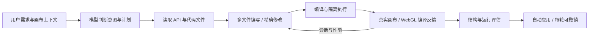
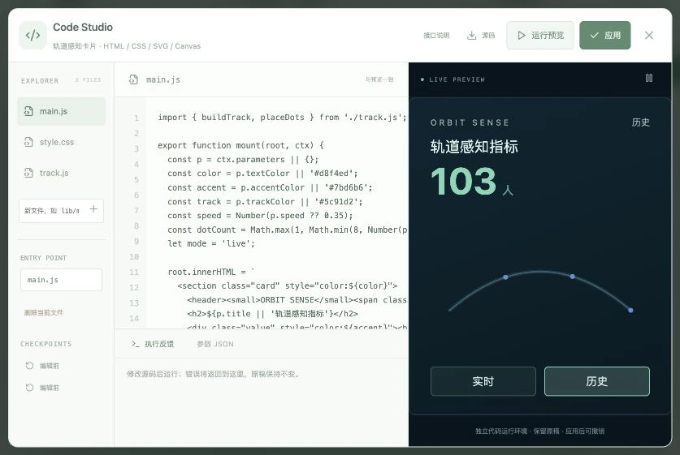

# Frontend code agent / 前端编程智能体

Astra 的编程范围是大屏前端。模型可以在每个组件的工作区中编写 JS、HTML、CSS、GLSL 与 JSON 文件，生成新的界面、几何体、材质和视觉算法。业务模型与动效由本轮源代码定义，没有按行业或天气名称分发固定模型的逻辑。

## 从编程智能体借鉴的结构

- [OpenCode 文件工具](https://docs.opencode.ai/docs/tools/)：读取、写入、精确编辑文件，执行检查并将结果返回模型。Astra 将这些能力限定在组件自己的前端工作区。
- [Cline 检查点](https://docs.cline.bot/core-workflows/checkpoints)：修改可比较、可回退。Astra 保存最近三个代码文件检查点；作品应用仍是一笔可撤销操作。
- [OpenHands 沙箱概念](https://docs.openhands.dev/openhands/usage/sandboxes/overview)：执行环境与用户作品分离。Astra 的场景代码运行在独立 Worker 的 [SES Compartment](https://docs.endojs.org/documents/guide.html) 中，自定义界面运行在无同源权限的 iframe 中。

这是前端运行环境，没有系统 Shell、服务器文件访问、npm 安装或后端代码执行工具。

完成检查的智能体结果会自动应用到画布，每轮应用保留独立撤销记录。后续指令从最新完整作品继续；若上一轮仍是未应用草稿，则沿用该草稿并保留原稿的版本校验。停止、运行错误和手动编辑冲突不会自动应用未完成的结果。

## 编程工具

| 工具 | 行为 |
| --- | --- |
| `get_code_api` | 获取对应运行入口、上下文、Three.js 能力与资源预算 |
| `list_code_files` | 列出文件、行数、版本和检查点 |
| `read_code_file` | 按行读取，返回带行号源码 |
| `write_code_files` | 原子写入多个源文件，暂不替换成功预览 |
| `edit_code_file` | 精确且唯一的文本替换，支持版本前置条件 |
| `delete_code_file` | 删除工作区文件，保留检查点 |
| `run_code` | 实际编译运行，返回 JS / GLSL 错误或运行统计 |
| `restore_code_checkpoint` | 恢复文件版本，再运行验证 |

## 接入已有 3D 场景

入口 `main.js` 导出 `build(THREE, ctx)`，返回 `{ root, update?, onEvent? }`。`root` 是 Group 或其他 Object3D，直接接到当前 Three.js 场景，不创建另一个 Renderer。`overlay` 保留基础世界，`replace` 隐藏基础世界并展示生成内容；手工添加的场景对象仍独立保存。

支持几何体组合、InstancedMesh、BufferGeometry、Points、线段、灯光、物理材质、ShaderMaterial 和 RawShaderMaterial。可将计算与模型构建拆到相对导入的 JS 文件，将顶点或片元代码拆到 `.glsl` / `.vert` / `.frag` 文件。导入 JSON、GLSL 时使用默认导入；不支持外部包、网络导入或循环模块依赖。

`ctx.parameters` 提供可编辑参数，`ctx.theme` 提供主题，`ctx.data` 提供组件绑定数据，`ctx.random()` 提供可复现随机数。`ctx.label(object, {name, description, status, rows})` 将对象接入现有 POI 信息面板。`onEvent` 接收生成标签的点击事件。

`update(time, delta)` 可改变对象变换、灯光、材质 uniforms，以及已有 BufferAttribute；修改缓冲后设置 `needsUpdate=true`。`uTime` / `time` 与 `uResolution` / `resolution` 由宿主同步。不在 update 中持续创建、删除节点或分配几何体；模型和缓冲一次构建，动画优先交给 GPU。

## 自定义前端组件

从组件库添加「代码组件」，入口导出 `mount(root, ctx)`。可自由创建 HTML、SVG、Canvas、CSS 动画和 DOM 交互；`index.html` 提供初始标记，工作区 CSS 文件自动合并。

- `ctx.data / theme / parameters / size / playing`：数据、主题、参数、尺寸与播放状态。
- `ctx.onFrame((time, delta, ctx) => {})`：与画布播放、暂停同步的动画。
- `ctx.onData((rows, ctx) => {})`：响应数据与参数更新。
- `ctx.emit('click' | 'hover', row)`：接入已有组件联动配置。

iframe 无同源权限，CSP 默认阻断外部连接、表单、外部脚本与外部资源。组件只能得到宿主明确提供的数据；模型密钥和账号凭据不进入该上下文。CSS 与 DOM 留在组件内部。

## Code Studio 与导出

选择支持代码的组件，点击「代码」或属性面板的「打开前端代码工作区」。支持文件管理、行号编辑、JSON 参数、场景组合方式、源码 ZIP 导出、检查点恢复、真实预览和编译诊断。修改后先运行，通过后才能应用；生成代码随项目 JSON、项目包和云端快照保存。

替换基础场景时，首次运行会按生成几何体的包围盒自动取景；近看、重置和俯视也以生成内容为目标。后续代码修改保留当前镜头，运行失败保留上次成功画面。

## 执行与性能边界

默认最多 20 个文件、单文件 60 KB、总源码 220 KB；场景最多 400 个节点、180,000 个顶点、3,000 个实例和 240 个绘制调用。实际目标应明显低于这些上限。Worker 具有启动、构建和动画超时，JS 循环与函数入口计步，GLSL 不接受无界循环。普通场景不会下载或启动代码 Worker。

这些是前端资源预算和故障回退机制，不是虚拟机级别的硬内存隔离。JS 语法、模块引用、实际 WebGL Shader 编译、运行异常和画布帧率会进入反馈；检查分数不等同于图片审美评分。复杂视觉仍需用户预览确认。

验证入口：`npm test`，其中 `verify-code.mjs` 覆盖实际 SES 执行、多文件模块、Shader 源检查、动画补丁、无界循环、网络与全局访问限制、精确编辑、检查点、运行失败回退与项目往返。
